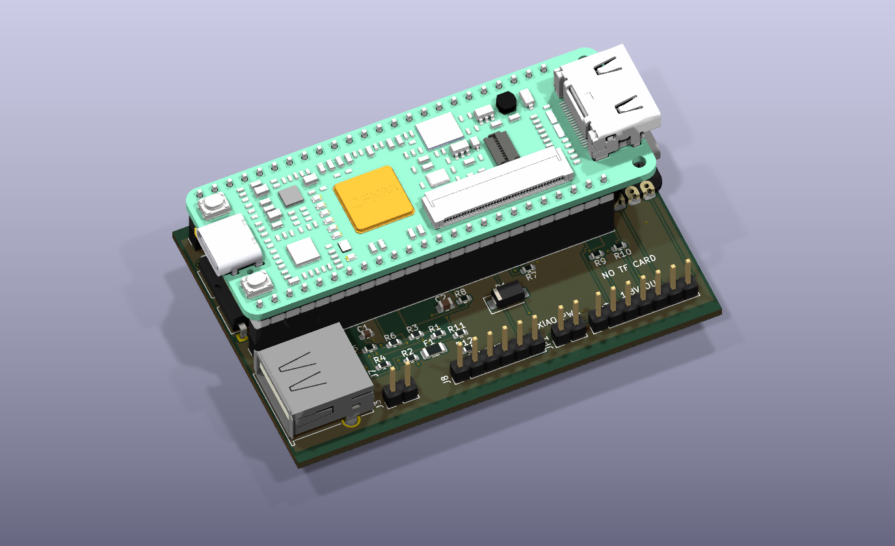

# KAGURA-6502

KAGURA-6502 は、実物の W65C02S を CPU に使う自作 6502 コンピュータです。専用キャリア基板 Rev.A に Tang Nano 9K と XIAO RP2040 を組み合わせ、HDMI ディスプレイと USB キーボードで使えるスタンドアロンの BASIC 機を目指しています。



*キャリア基板 Rev.A（72 × 48 mm、4 層）の設計データから生成したイメージ。*

| 構成 | 役割 |
| --- | --- |
| W65C02S | 3.375 MHz で BIOS と KAGURA BASIC を実行 |
| Tang Nano 9K | CPU バス、PSRAM 主記憶、8 KiB 高速 RAM、2 KiB Boot ROM。320×176 のタイル・スプライト映像を HDMI 720p60 で出力し、6ch 音源を HDMI / PWM に出力 |
| XIAO RP2040 | CPU のリセットを監督。キャリア基板の USB-A にキーボードをつなぐための配線を備える |

**RTL v1.0 RC は W65C02S 実機照合待ちです。** 現行版のコンソールは Tang Nano 9K の USB シリアルです。BIOS から KAGURA BASIC を UART でロードします。基板上の USB-A からキー入力を使うには、XIAO の USB ホスト／HID ファームウェアと、FPGA のコンソール入力経路の実装が必要です。

[GitHub Releases](https://github.com/siska-tech/kagura-6502/releases/tag/v1.0-rc.1) で bitstream、ガーバー・ドリル、組み立て指南書をまとめて配布しています。回路図と PCB は [KiCad プロジェクト](board/kagura-6502.kicad_pro) を開いて確認できます。

## 検証状況

この RC の bitstream は [aud_p1024.fs](release/aud_p1024.fs) の 1 点です。[SHA-256](release/SHA256SUMS) を照合できます。RTL の基準はローカル実装コミット `fdbc3a0`、Gowin Commercial 1.9.12.04、place option 2 / route option 1 です。保存済みの [統合シミュレーション](build-logs/audio/sim_system/sys_a1024_aud.log) は PASS、[STA](build-logs/audio/aud_p1024/aud_p1024.tr) は Setup / Hold 違反 0 / 0、[資源レポート](build-logs/audio/aud_p1024/aud_p1024.rpt.txt) は BSRAM 26 / 26 です。実機での CPU 起動、PSRAM、映像・音声は未確認です。波形チャンネルは 256 サンプル固定です。

**Tang Nano 9K の TF スロットにカードを挿さないでください。** CPU アドレス線 A8–A11 と信号を共有します。[ピン割当](docs/pinmap.md) を参照してください。

## 再現

Gowin Commercial 1.9.12.04 と Git Bash で `bash fpga/audio/syn/build_audio.sh aud_p1024` を実行します。生成先は `fpga/audio/syn/impl_aud_p1024/impl/pnr/aud_p1024.fs` です。保存レポートはビルド時に更新されます。

統合シミュレーションは WSL 上の Verilator 5.032 を使用します。ローカルの 6502-sim リポジトリを環境変数 `SIM6502` で指定してください。スクリプトがコミット `f00df4cb3bf639270f294965de1dea98bb55cfce` を参照します。

```sh
bash fpga/tools/build_cc65.sh
bash fpga/basic/sw/build_sw.sh
bash fpga/audio/sim/run_audio.sh all
bash fpga/vdp/sim/run_system.sh sys_a1024_aud
```

第三者ソースの表示とライセンスは [THIRD_PARTY.md](THIRD_PARTY.md) を参照してください。KAGURA-6502 自体のライセンスは未決定です。
